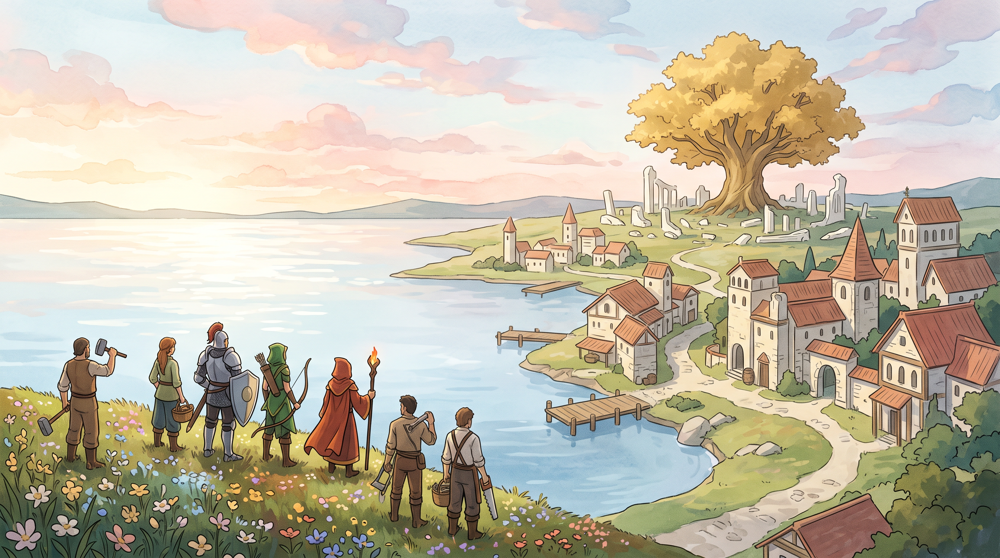

# 暁のギルド

[Español](README.md) · [English](README.en.md) · [Português](README.pt.md) · [日本語](README.ja.md) · [العربية](README.ar.md) · [Deutsch](README.de.md) · [Français](README.fr.md)

ブラウザで遊べる**オープンソース**のファンタジーRTSです。名前を持つ村人、
ギルド、建設、資源、城壁、戦闘、そしてスペイン語による命令を備えています。

現在の範囲は、探索済みのマップ上で経済・建設・戦闘を行う、AIとの対戦や
小規模な戦い（スカーミッシュ）です。キャンペーンは含まれていません。



## ローカルで遊ぶ

必要なもの：**Node.js 24以降**とモダンブラウザ。インストールが必要なnpm依存
パッケージはありません。

```sh
git clone https://github.com/Oruga420/gremios-del-alba.git
cd gremios-del-alba
npm start
```

**http://127.0.0.1:4173** を開いてください。Windowsでは `PLAY.cmd` も使えます。
サーバーはローカルでの利用を想定しており、ループバックで待ち受けます。

## 含まれるもの

- 完全に探索済みの10のマップと、4つのオリジナルギルド。
- 採集、運搬、搬入。村人は資源が尽きると到達できる別の資源を探し、倉庫が
  ない場合は積荷を持ったままでいます。
- 建設、修理、城壁、門。
- 横列・方陣・千鳥の陣形。各ユニットに個別の目的地を割り当て、経路を共有
  します。選んだ陣形はグループを移動しても保たれます。
- 資源や菜園への集合地点：新しい働き手は建物から出るとすぐに採集を始めます。
- 募兵、技術、時代、交易、そして1つの街につき1,000人の住民上限。
- 騎士、弓兵、暗殺者、魔術師、癒し手などの役割。戦闘アニメーション、血、
  亡骸の表現。
- JSONでのセーブ／ロード、ドラッグ選択、グループ、ミニマップ。
- スペイン語の命令パーサーと、WebMCPのページツール。
- ユーザー自身のアカウントと認証情報を使う、任意の音声エージェント。

ドラッグでユニットを選択し、右クリックで命令を出します。下部のカードで建設や
訓練を行い、スペースキーで一時停止します。ゲーム内のヘルプにはさらに多くの
操作方法が載っています。複数のユニットを選択しているときは、**横列**、
**方陣**、**千鳥**のボタンで組み直せます。生産施設を選択して資源を右クリック
すると、新しい働き手をそこへ送れます。選択パネルには積荷のほか、採集中か、
搬入中か、到達できる資源や倉庫を待っているかが表示されます。

同じ資源に採集命令を繰り返しても、作業、経路、積荷はそのまま保たれます。
攻撃移動中、自動で発見した敵に到達できない場合、ユニットは元の目的地へ
向かい直します。明示的な攻撃では、選んだ目標が保たれます。

## 音声とWebMCP

文字による命令とゲーム本体はAPIキーなしで動作します。ブラウザの音声認識は、
そのブラウザの対応状況と権限に左右されます。命令の例：
**「家を建てて」**、**「村人は木材を集めて」**、**「横一列に並んで」**、
**「千鳥の陣形」**、**「弓兵を方陣で基地に移動して」**、
**「ギルドホールの集合地点を森に設定して」**。日本語の命令はスペイン語の命令
パーサー向けに書き換えられるため、**「construye una casa」**、
**「aldeanos, recoge madera」**、**「forma en línea」**、
**「formación escalonada」**、**「mueve los arqueros en caja a mi base」**、
**「punto de reunión del centro urbano al bosque」** といった元のスペイン語の
命令もそのまま使えます。目的地は現在の世界に照らして解決されます。命令は確認や
座標の指定なしにすぐ実行され、**「止まれ」**（**「Alto」**）でユニットが停止します。

会話型エージェントを使うには、ElevenLabsで自分専用の非公開Agentを作成し、
`.env.example` を `.env` にコピーします。`ELEVENLABS_API_KEY` と
`ELEVENLABS_AGENT_ID` を設定し、サーバーを再起動してください。キーは
サーバー側に留まります。プロバイダーの利用は任意で、あなたのアカウントに
費用が発生する場合があります。
`npm run voice:definition` は、ゲームのツールを含む定義をローカルに書き出します。
声とモデルはプロバイダー側、またはサンプルのオプションで選んでください。
ゲームをインストールしただけでエージェントが作られたり、通話が行われたり
することはありません。

オフライン認識は任意で、Python、Vosk、FFmpeg、そしてスペイン語のモデルが
必要です。`GUILD_PYTHON_PATH`、`GUILD_FFMPEG_PATH`、
`GUILD_VOSK_MODEL_PATH` を設定してください。モデルや録音データは同梱されて
いません。

`PLAY-WEBMCP.cmd` は、WebMCPフラグを有効にした対応Chromeを専用のローカル
プロファイルで起動します。ゲームは実際に利用できる機能を表示します。この
プロファイルには独自のセーブデータがあるため、ゲームを移すにはJSONの
エクスポート／インポートを使ってください。

## 開発とテスト

```sh
npm test
npm run check
npm run build
```

`dist/` には生成された静的クライアントが入ります。ローカルサーバーには音声と
オフライン認識のルートが含まれます。Vercelでは、`api/guild.mjs` がSotaの
ルートを提供するため、コンピューターを起動したままにしておく必要はありません。
ツールの一覧は `docs/voice/clickables.json` に、エンジンの仕様は
`docs/engine-interface.md` にあります。

### Vercelへのデプロイ

このリポジトリをNode 24でインポートし、`vercel.json` はそのまま残してください。
クライアントは `dist/` にビルドされ、`/api/*` のルートは追加の依存関係を
持たないNode関数として実行されます。セーブデータはブラウザに保存されるか、
JSONとしてエクスポートされます。Voskによるオフライン認識はローカル版でのみ
利用でき、Vercelの公開リンクではブラウザの音声認識を使うか、命令を入力して
ください。

プロジェクトで **Vercel Authentication → Standard Protection** を有効にして
ください。本番ドメインではログインせずに遊べます。デプロイごとの固有アドレスは
非公開のままです。個人用のSotaは、Vercelが `VERCEL_URL` で渡す保護された
ホストからのみ認可を発行します。ブラウザの音声認識と文字による命令は、公開版の
ゲームでも利用できます。暗号化された本番環境変数として
`ELEVENLABS_API_KEY`、`ELEVENLABS_AGENT_ID`、
`GUILD_PUBLIC_ORIGIN`（正確なHTTPSオリジン）、`GUILD_SESSION_SECRET`（ランダムな
32文字以上の値）、`GUILD_DEPLOYMENT_PROTECTION=vercel-auth` を設定してください。
これらの値をGitHubに含めないでください。このインジケーターは設定済みの保護を
宣言するものであり、Vercelのアクセス制御の代わりにはなりません。有料の
エージェントを有効にする場合は、固有アドレスの保護を無効にしないでください。
公開ドメインは、有効なセッションとCSRFがあってもElevenLabsの認可を発行しません。

セッションとCSRFには、署名付きで HttpOnly、Secure、SameSite のCookieを
使います。発行数と同時通話数の上限は関数のインスタンスごとのもので、
全体の割り当てや請求上限と同じではありません。非公開アクセスは保護したままに
し、プロバイダー側で利用上限を設定してください。クライアントの通話は5分で、
または90秒間操作がないと終了します。

それぞれ120秒の任意のベンチマークが2つあります。負荷が混ざらないよう、
別々に実行してください。

```sh
npm run benchmark
node scripts/benchmark-formations.mjs
```

1つ目は、1つの街につき1,000人の住民による戦闘と経済のシナリオを維持します。
2つ目は、経済を動かしながら3つの陣形を試します。生成されるローカルレポートには
シナリオ、測定値、その限界が記載されます。非公開の結果は含まれず、他の
コンピューターでの性能を前提にもしていません。

ブラウザテストには、Playwrightとそのブラウザを別途インストールする必要が
あります。これらは遊ぶための依存関係ではありません。ハーネスのPython回帰
テストと、`scripts/run-browser-acceptance.py` のランナーがあります。

## プロジェクトの状況

開発中のプロトタイプです。移動中のローカルな分離は近似的なもので、重なりが
生じることがあります。表示の補間や、密集した状況での挙動の改善はまだ残って
います。大きな負荷での性能はシナリオとハードウェアによって異なります。
ブラウザの完全なハーネスでは、Chrome/Playwrightの終了に関する問題が見られて
います。部分的な確認は完全なE2Eテストと同等ではありません。

移動、陣形、採集は独自の実装です。REAによる参考調査は部分的なままで、
Age of Empiresのナビゲーション、陣形、採集の正確なアルゴリズムは復元できて
いません。そのエンジンと同等であるとは主張しません。

このリポジトリには独自のコードと生成されたリソースが含まれています。復元された
商用エンジン、Age of Empiresのファイル、アカウントデータ、非公開の開発履歴、
共有キーは含まれていません。

## ライセンスとコントリビューション

**独自のコードとドキュメント：MIT。同梱のアート：CC BY 4.0**（帰属表示が
必要）。サードパーティのソフトウェアはそれぞれのライセンスに従います。
`LICENSE`、`assets/LICENSE.md`、`THIRD_PARTY_NOTICES.md` を参照してください。

これらのライセンスを守る限り、プロジェクトを使用、改変、再配布できます。
IssueやPull Requestを歓迎します。エンジンの変更には再現可能なテストを含め、
部分的な測定を完全な受け入れ基準として示さないようにしてください。
