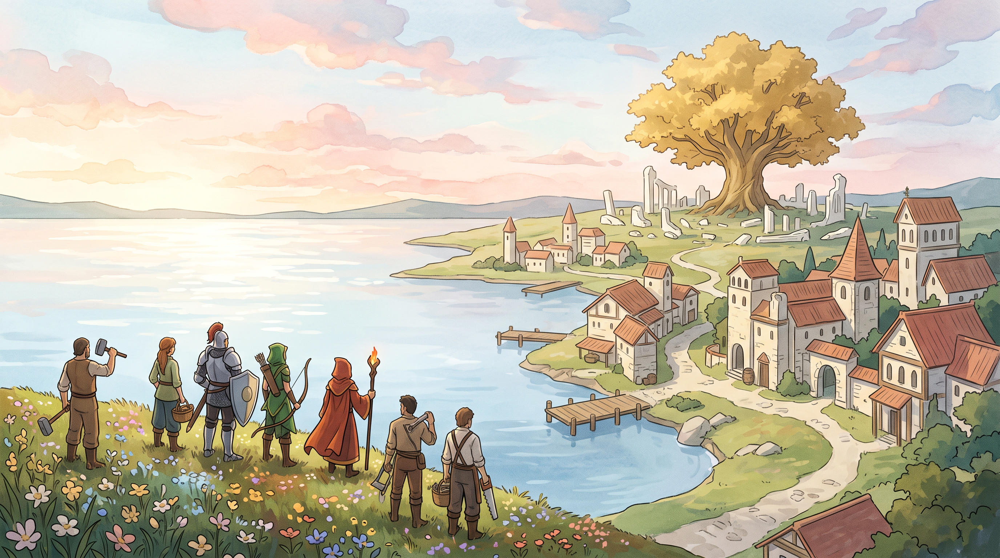

# Gremios del Alba

Un RTS de fantasía **open source**, jugable en el navegador, con aldeanos con
nombre, gremios, construcción, recursos, murallas, combate y órdenes en español.



## Jugar localmente

Requisitos: **Node.js 24 o posterior** y un navegador moderno. No hay dependencias
npm que instalar.

```sh
git clone https://github.com/Oruga420/gremios-del-alba.git
cd gremios-del-alba
npm start
```

Abre **http://127.0.0.1:4173**. En Windows también puedes usar `PLAY.cmd`.
El servidor está diseñado para uso local y escucha en loopback.

## Qué incluye

- Diez mapas completamente descubiertos y cuatro gremios originales.
- Recolección, transporte y depósito de recursos; construcción, reparación,
  murallas y puertas.
- Reclutamiento, tecnologías, eras, comercio y límite de 1,000 habitantes por ciudad.
- Caballeros, arqueros, asesinos, magos, sanadores y otros roles; animaciones de
  combate, sangre y cuerpos.
- Guardado/carga JSON, selección por arrastre, grupos y minimapa.
- Parser de órdenes en español y herramientas de página WebMCP.
- Agente de voz opcional con una cuenta y credenciales del propio usuario.

Selecciona unidades arrastrando; haz clic derecho para dar una orden. Usa las
tarjetas inferiores para construir o entrenar y la barra espaciadora para pausar.
La ayuda del juego contiene más controles.

## Voz y WebMCP

Las órdenes escritas y el juego funcionan sin API keys. El reconocimiento de voz
del navegador depende de su compatibilidad y permisos. Ejemplos de órdenes:
**«construye una casa»**, **«aldeanos, recoge madera»**, **«ataca la base enemiga»**.
Los destinos semánticos se resuelven contra el mundo actual.

Para el agente conversacional, crea tu propio Agent privado en ElevenLabs y
copia `.env.example` a `.env`. Define `ELEVENLABS_API_KEY` y
`ELEVENLABS_AGENT_ID`; después reinicia el servidor. La clave permanece en el
servidor. El uso del proveedor es opcional y puede tener coste en tu cuenta.
`npm run voice:definition` exporta localmente una definición con las herramientas
del juego; selecciona tu voz y modelo en el proveedor o mediante las opciones
del ejemplo. No se crean agentes ni se realizan llamadas por instalar el juego.

El reconocimiento offline es opcional y requiere Python, Vosk, FFmpeg y un
modelo de español. Configura `GUILD_PYTHON_PATH`, `GUILD_FFMPEG_PATH` y
`GUILD_VOSK_MODEL_PATH`. No se incluyen modelos ni grabaciones.

`PLAY-WEBMCP.cmd` inicia un Chrome compatible con el flag WebMCP y un perfil
local dedicado. El juego informa la capacidad realmente disponible. Ese perfil
tiene su propio guardado: usa exportar/importar JSON para trasladar una partida.

## Desarrollo y pruebas

```sh
npm test
npm run check
npm run build
```

`dist/` contiene el cliente estático generado. Un hosting estático permite el
juego, pero las rutas de voz `/api/*` necesitan el servidor local. El inventario
de herramientas está en `docs/voice/clickables.json`; el contrato del motor está
en `docs/engine-interface.md`.

El benchmark opcional dura 120 segundos:

```sh
npm run benchmark
```

Las pruebas de navegador requieren instalar Playwright y su navegador por
separado; no son una dependencia para jugar. Hay regresiones Python del arnés y
un runner en `scripts/run-browser-acceptance.py`.

## Estado del proyecto

Es un prototipo en desarrollo. Faltan separación durante el movimiento,
formaciones completas, interpolación visual y mejoras de navegación con muchos
objetivos de combate distintos. El comportamiento con cargas grandes depende
del escenario y hardware. El arnés completo de navegador ha mostrado problemas
de cierre de Chrome/Playwright; una comprobación parcial no equivale a E2E completo.

Este repositorio contiene código propio y recursos generados. No contiene un
motor comercial recuperado, archivos de Age of Empires, datos de cuentas,
historial privado de desarrollo ni claves compartidas.

## Licencias y contribuciones

**Código y documentación propios: MIT. Arte incluido: CC BY 4.0**, con atribución.
El software de terceros conserva sus licencias. Consulta `LICENSE`,
`assets/LICENSE.md` y `THIRD_PARTY_NOTICES.md`.

Puedes usar, modificar y redistribuir el proyecto respetando esas licencias.
Issues y pull requests son bienvenidos. Para cambios del motor, incluye una
prueba reproducible y evita presentar mediciones parciales como aceptación completa.
